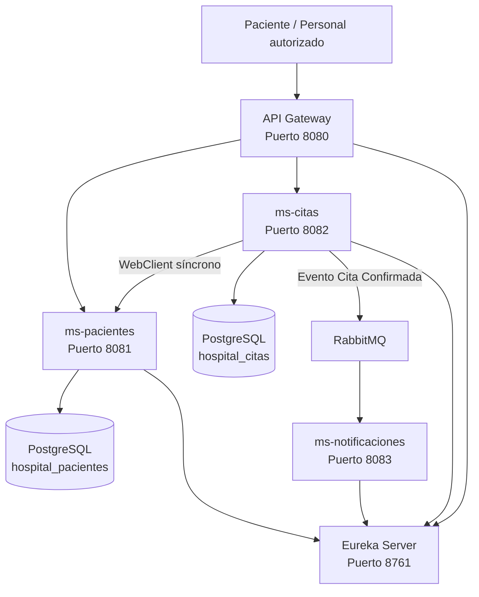

# Hospital Vida Salud - T2

Examen T2 para el curso de **Desarrollo de Aplicaciones Web II**.

La solución moderniza un sistema hospitalario monolítico mediante una arquitectura basada en microservicios, utilizando Spring Boot, Spring Cloud Gateway, Eureka Discovery Server, RabbitMQ, PostgreSQL, Spring Data R2DBC, Spring WebFlux y GitHub Actions.

---

## 1. Objetivo

Implementar un flujo hospitalario administrativo distribuido que permita:

- Registrar y consultar pacientes.
- Evitar pacientes duplicados.
- Registrar y consultar citas.
- Validar que el paciente exista antes de crear una cita.
- Controlar estados de las citas.
- Evitar citas incompatibles o duplicadas.
- Publicar un evento cuando una cita es confirmada.
- Consumir el evento mediante un servicio de notificaciones.
- Persistir información utilizando PostgreSQL y R2DBC.
- Ejecutar pruebas automatizadas.
- Validar automáticamente el proyecto mediante GitHub Actions.

---

## 2. Arquitectura



---

## 3. Microservicios

| Componente | Puerto | Responsabilidad |
|---|---:|---|
| Eureka Server | 8761 | Registro y descubrimiento de servicios |
| API Gateway | 8080 | Punto de entrada y enrutamiento |
| ms-pacientes | 8081 | Registro, consulta y validación de pacientes |
| ms-citas | 8082 | Registro, consulta y administración de citas |
| ms-notificaciones | 8083 | Consumo de eventos RabbitMQ y simulación de notificaciones |

---

## 4. Tecnologías utilizadas

- Java 21
- Spring Boot 4.1.1
- Spring Cloud
- Spring Cloud Gateway
- Eureka Discovery Server
- Spring WebFlux
- Reactor Mono y Flux
- Spring Data R2DBC
- PostgreSQL
- RabbitMQ
- Maven Wrapper
- JUnit 5
- Mockito
- WebTestClient
- Git
- GitHub
- GitHub Actions
- Postman

---

## 5. Persistencia

Se utilizan dos bases de datos PostgreSQL independientes:

```text
hospital_pacientes
hospital_citas
```

Cada microservicio es responsable de sus propios datos.

`ms-citas` no accede directamente a las tablas de `ms-pacientes`. La validación del paciente se realiza mediante comunicación síncrona entre servicios.

---

## 6. Programación reactiva

Los microservicios utilizan:

- Spring WebFlux.
- `Mono<T>` para operaciones que retornan cero o un elemento.
- `Flux<T>` para colecciones.
- Repositorios reactivos mediante Spring Data R2DBC.
- Manejo reactivo de errores.
- WebClient para comunicación síncrona entre microservicios.

---

## 7. Comunicación síncrona

Antes de registrar una cita, `ms-citas` consulta a `ms-pacientes` mediante WebClient.

Flujo:

```text
Cliente
   ↓
API Gateway
   ↓
ms-citas
   ↓
WebClient
   ↓
ms-pacientes
   ↓
Validación del paciente
```

Si el paciente no existe o se encuentra inactivo, la cita es rechazada.

---

## 8. Comunicación asíncrona con RabbitMQ

Cuando una cita cambia al estado `CONFIRMADA`, `ms-citas` publica un evento en RabbitMQ.

Flujo:

```text
ms-citas
   ↓
Evento de cita confirmada
   ↓
RabbitMQ
   ↓
hospital.notificaciones.queue
   ↓
ms-notificaciones
   ↓
Notificación simulada en consola
```

El consumidor recibe información como:

- ID de cita.
- Código de cita.
- Paciente.
- Especialidad.
- Fecha y hora.
- Profesional.
- Estado.
- Fecha del evento.

---

## 9. Reglas de negocio implementadas

### Pacientes

- No se permite registrar dos pacientes con el mismo tipo y número de documento.
- Los pacientes registrados se crean en estado `ACTIVO`.
- Se manejan respuestas HTTP apropiadas para recursos inexistentes y duplicados.

### Citas

Estados utilizados:

```text
PENDIENTE
CONFIRMADA
ATENDIDA
CANCELADA
AUSENTE
```

Transiciones principales:

```text
PENDIENTE
 ├── CONFIRMADA
 └── CANCELADA

CONFIRMADA
 ├── ATENDIDA
 ├── CANCELADA
 └── AUSENTE
```

No se permiten transiciones desde:

```text
ATENDIDA
CANCELADA
AUSENTE
```

También se valida que:

- El paciente exista.
- El paciente esté activo.
- Un paciente no tenga otra cita en la misma fecha y hora.
- Un profesional no tenga dos citas en la misma fecha y hora.

---

## 10. Endpoints principales

Todos los accesos externos se realizan mediante el API Gateway.

### Pacientes

```http
POST /api/pacientes
GET /api/pacientes
GET /api/pacientes/{id}
GET /api/pacientes/documento/{tipoDocumento}/{numeroDocumento}
```

### Citas

```http
POST /api/citas
GET /api/citas
GET /api/citas/{id}
GET /api/citas/paciente/{pacienteId}
PATCH /api/citas/{id}/estado
```

Ejemplo para confirmar una cita:

```json
{
  "estado": "CONFIRMADA"
}
```

---

## 11. Variables de entorno

Las credenciales no se almacenan directamente en el repositorio.

### PostgreSQL

```text
DB_PASSWORD
```

Opcionalmente pueden configurarse:

```text
DB_USER
PACIENTES_DB_URL
CITAS_DB_URL
```

### RabbitMQ

```text
RABBITMQ_USER
RABBITMQ_PASSWORD
```

Opcionalmente:

```text
RABBITMQ_HOST
RABBITMQ_PORT
```

Nunca deben publicarse contraseñas reales en GitHub.

---

## 12. Orden de ejecución

Para ejecutar el sistema localmente:

1. Iniciar PostgreSQL.
2. Iniciar RabbitMQ.
3. Ejecutar `eureka-server`.
4. Ejecutar `ms-pacientes`.
5. Ejecutar `ms-citas`.
6. Ejecutar `ms-notificaciones`.
7. Ejecutar `api-gateway`.

Luego verificar Eureka en:

```text
http://localhost:8761
```

Deben aparecer:

```text
API-GATEWAY
MS-PACIENTES
MS-CITAS
MS-NOTIFICACIONES
```

todos en estado `UP`.

---

## 13. Pruebas automatizadas

Se implementaron pruebas unitarias, de controlador y de mensajería.

### ms-pacientes

```text
PacienteServiceTest       → 5 pruebas
PacienteControllerTest    → 5 pruebas
```

### ms-citas

```text
CitaServiceTest           → 9 pruebas
CitaControllerTest        → 6 pruebas
```

### ms-notificaciones

```text
CitaEventoListenerTest    → 2 pruebas
```

También existen pruebas de contexto para Eureka Server y API Gateway.

El pipeline de GitHub Actions ejecuta **29 pruebas seleccionadas** automáticamente.

---

## 14. Ejecutar pruebas localmente

Desde cada microservicio se puede ejecutar:

### Windows

```bash
mvnw.cmd test
```

### Git Bash / Linux

```bash
./mvnw test
```

---

## 15. Integración continua

El proyecto utiliza GitHub Actions mediante:

```text
.github/workflows/ci.yml
```

El workflow se ejecuta automáticamente en:

```text
push → main
pull_request → main
```

El proceso realiza:

```text
Checkout
   ↓
Java 21
   ↓
Caché Maven
   ↓
Compilación
   ↓
Pruebas automatizadas
   ↓
Resultado verificable
```

Se realizó además una prueba controlada:

1. Se creó una rama temporal.
2. Se agregó una prueba intencionalmente incorrecta.
3. GitHub Actions detectó el error.
4. El job de `ms-pacientes` quedó en rojo.
5. Se corrigió la prueba.
6. GitHub Actions volvió a ejecutar el pipeline.
7. Los cinco jobs finalizaron correctamente.

Esto demuestra que el proceso de CI detecta cambios defectuosos antes de integrarlos.

---

## 16. Flujo funcional demostrado

```text
Postman
   ↓
API Gateway
   ↓
ms-citas
   ↓
Validación síncrona en ms-pacientes
   ↓
PostgreSQL mediante R2DBC
   ↓
Cambio de estado a CONFIRMADA
   ↓
RabbitMQ
   ↓
ms-notificaciones
```

---

## 17. Seguridad y datos

El proyecto es exclusivamente académico.

- Los datos utilizados son ficticios.
- No contiene información clínica real.
- No se almacenan tokens en el repositorio.
- Las credenciales se gestionan mediante variables de entorno.
- No se registran contraseñas en los logs.

---

## 18. Repositorio

Proyecto T2 - Hospital Vida Salud.

Repositorio:

```text
https://github.com/dgaribaldi89/hospital-vida-salud-t2
```

---

## 19. Autor

**David Enrique Garibaldi Huanca**
Desarrollo de Aplicaciones Web II  
2026